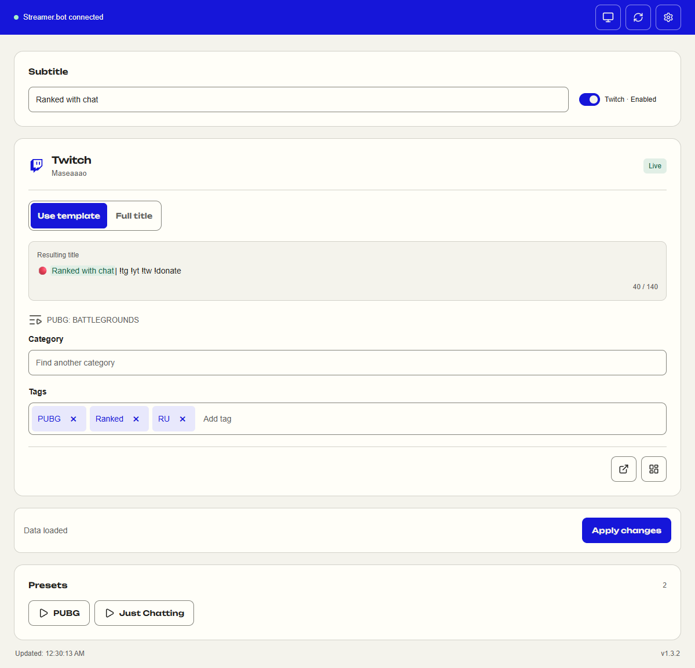
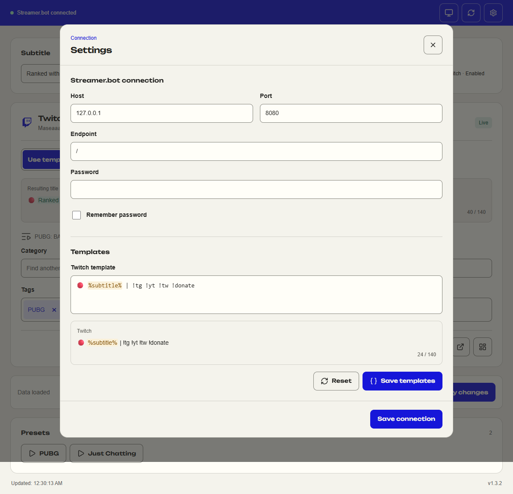

# Stream Info for Streamer.bot

[Русская версия](README.ru.md)

One self-contained HTML control surface for updating Twitch stream metadata from an OBS dock. It connects only to Streamer.bot’s local WebSocket; there is no hosted service, OAuth page, or external UI dependency.



Version 1.3.2 interface; screenshots refreshed on October 19, 2026. Titles, categories, and tags are edited on the main page. The gear button opens connection settings and title templates.

## What it does

- Updates titles, categories, and tags on Twitch.
- Keeps reusable Twitch title templates in Streamer.bot global variables.
- Discovers `PRESET | …` Actions in the `STREAM INFO` group for game presets.
- Ships as a single file that can be opened directly with `file://`.
- Builds fully localized HTML in Russian, English, Spanish, and Simplified Chinese.
- Preserves Twitch update selection and drafts across data refreshes and Settings.
- Supports keyboard-driven Twitch category search, retry, and more results.

## Quick start

1. Download and open [change-info-streamer-bot.html](change-info-streamer-bot.html).
2. Make sure Streamer.bot’s built-in WebSocket server is enabled.
3. If prompted, copy [streamerbot-import.txt](streamerbot-import.txt), select **Import** in Streamer.bot, and complete the import.
4. Return to Stream Info and select **Check again**.

The page automatically connects to `ws://127.0.0.1:8080/`. If your WebSocket requires a password, enter it in the compact connection panel or in Settings. Twitch credentials remain inside the Streamer.bot Action and are never embedded in the HTML file.

The import requires Streamer.bot 1.0.6 or later. Connect Twitch in Streamer.bot and enable `STREAM INFO | API`. Twitch metadata can also be updated while offline.

## Using the OBS dock

Open the chosen HTML through an OBS custom browser dock using its local `file:///…` URL. Dock it wherever convenient; the Twitch card uses the full panel width.

1. Enable Twitch updates using the switch beside **Subtitle**. Disabled cards are hidden and retain their drafts.
2. Enter the shared subtitle and check the resulting titles. Twitch starts in **Use template** mode when the page opens.
3. Switch a card to **Full title** to enter a separate title. The next subtitle edit returns Twitch to template mode.
4. Select a category from suggestions, add tags with Enter, and remove tags with the cross button. Select a result or clear an unfinished category query.
5. Select the shared **Apply** button to save the subtitle and send changed fields to connected Twitch. Check the error messages.

The header refresh button rereads state while retaining unsaved edits. Card footer buttons open the stream and platform dashboard; game presets appear below the cards. A preset runs its Action and can change metadata according to that Action's own settings.

Twitch update selection and connection settings are saved in this browser. The password is stored only when **Remember password** is enabled. Templates and the subtitle are stored in persistent Streamer.bot globals; moving the HTML does not transfer browser settings or drafts.

## Languages and builds

The checked-in `change-info-streamer-bot.html` is the Russian default for direct use. Run the build to create all standalone variants:

```powershell
npm install
npm run build
```

| Language | Generated file |
| --- | --- |
| Russian | `dist/change-info-streamer-bot.ru.html` |
| English | `dist/change-info-streamer-bot.en.html` |
| Spanish | `dist/change-info-streamer-bot.es.html` |
| Simplified Chinese | `dist/change-info-streamer-bot.zh.html` |

For a safe visual tour with sample data, append `?demo=1` to any built HTML file. Demo mode does not connect to Streamer.bot or make platform changes.

## Connection and template settings

The gear button opens Host, Port, Endpoint, and WebSocket password settings. **Save connection** saves connection settings. Templates have a separate **Save templates** button: check the previews and length counters first. **Reset** fills the editors with default templates; save them to persist the reset. Closing Settings preserves unsaved main-page edits. Uncommitted template edits survive a reload in the same browser tab (session storage) until you save them to Streamer.bot; they are not shared with other tabs or devices.



## Updating an installed panel

Replace the HTML at the actual path used by the OBS dock, then reload the dock. Building `dist/` does not update an external copy automatically. If C# or the import changed, re-import the new `streamerbot-import.txt` and check Execute Code compilation in Streamer.bot. Back up working files before replacing them.

If the panel reports a missing, disabled, or outdated Action, check `STREAM INFO | API`, complete the suggested import, and select **Check again**. For connection problems, compare Host, Port, Endpoint, and password with Streamer.bot's WebSocket settings.

## Category search

Twitch search merges full-name/ID lookup candidates with autocomplete instead of hiding alternatives after a lookup succeeds. Ranking accounts for whitespace, punctuation, diacritics and Unicode while preserving original names and IDs. Numeric input can be a title or an ID. Common CS2, LoL, GTA5 and WoW retrieval hints are configured in `streamerbot/category-search-service.cs`; hints expand provider queries, not the selected category.

Results appear in batches of 20 after ranking. More reveals additional candidates and fetches continuation pages when needed. A provider's first page is not assumed to be the complete catalog. Successful searches use a bounded 30-second cache; failed and partial responses are not cached. The separate five-second stream-state cache is unchanged.

Use arrows to activate an option, Enter to select it, and Escape to clear the query. The actual selected category stays visible. Select a result or clear an unresolved query before applying changes; typed text never implicitly changes metadata. Settings and background refresh preserve the draft. Errors differ from no matches, with retry and partial-result warnings.

Run `node scripts/verify-category-search-live.mjs` for safe acceptance checks against an installed Action. It only searches categories and never applies metadata or runs presets. After a C# change, update the Action from the new import and separately refresh the HTML at the actual OBS dock path.

## Templates and presets

The Twitch title template is configured in **Settings** and can contain at most one `%subtitle%` token. **Subtitle** supplies that token's value.

The Twitch switch enables updates and remembers the choice in this browser. Edit the title, category, and tags in the Twitch card. **Use template** generates the title from the subtitle; **Full title** accepts manual text. Changing the subtitle restores template mode. **Apply** saves the subtitle and changed fields for connected Twitch. Disabled cards retain their drafts. Refreshing data and closing Settings preserve unsaved edits.

To create a game preset, make an Action in the `STREAM INFO` group named `PRESET | Game name`. Set any of the following persistent global variables, then call `STREAM INFO | API` with `command = applyPreset`:

| Variable | Meaning |
| --- | --- |
| `stream_info.template.twitch` | Twitch title template |
| `stream_info.template.subtitle` | Subtitle |
| `stream_info.preset.twitchCategoryId` | Twitch category ID |
| `stream_info.preset.twitchTagsJson` | Twitch tag JSON array |

Empty category and tag variables leave those fields unchanged.

When upgrading to Twitch-only support, re-import `streamerbot-import.txt` to replace the existing `STREAM INFO | API`. Remove its old Broadcast Started trigger if the importer retains it. Action and Execute Code IDs are unchanged, so game presets still call the same API. Legacy variables for the removed platform are no longer read.

## Development

```powershell
npm install
npm run check
npm test
npm run build
```

The test suite requires Node.js and the .NET 8 SDK. `npm run build` regenerates the native Streamer.bot import, checks TypeScript, and emits all four single-file HTML variants. `dist/` is committed because it is the distributable product; include its refreshed files whenever a change affects the build.

## Releases

Pushing a tag named `v*` creates a GitHub Release containing each HTML file from `dist/` and a ZIP archive of the complete distribution. End users can download the language they need without installing Node.js or building the project.

## Security and support

Please read [SECURITY.md](SECURITY.md) before reporting a vulnerability. For contribution expectations, see [CONTRIBUTING.md](CONTRIBUTING.md) and [CODE_OF_CONDUCT.md](CODE_OF_CONDUCT.md).

## Credits

The main visual design reference is [Hermes Desktop](https://hermes-agent.nousresearch.com/desktop) by Nous Research, which inspired the project's palette, typography, component shapes, and composition.

Thank you to [nutty.gg](https://nutty.gg/) for the idea and inspiration behind the focused streamer control-surface direction.

## License

[MIT](LICENSE) © 2026 maxxborer
