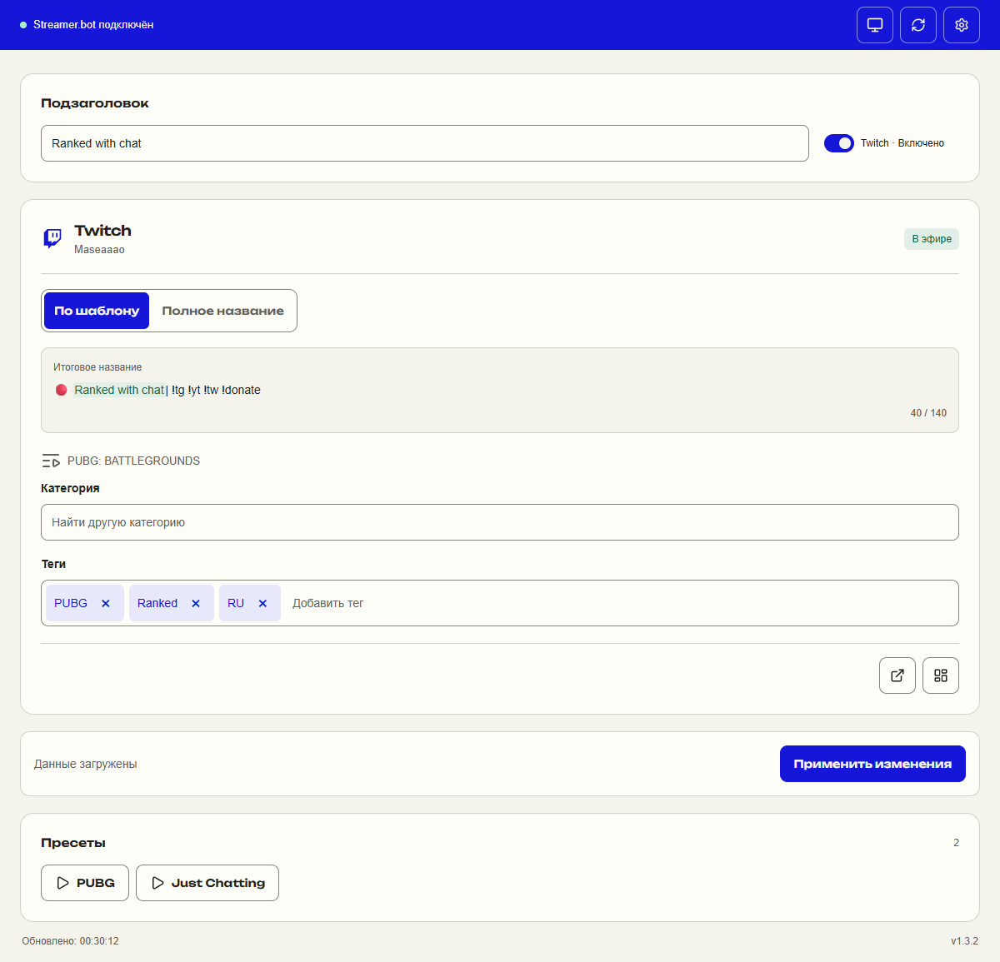
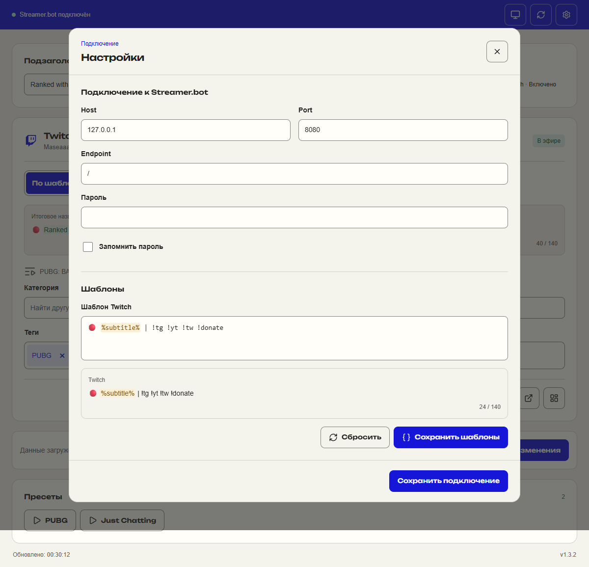

# Stream Info для Streamer.bot

[English version](README.md)

Самодостаточная HTML-панель для обновления информации Twitch прямо из OBS Dock. Она подключается только к локальному WebSocket Streamer.bot: без сервера, OAuth-страницы и внешних UI-зависимостей.



Интерфейс версии 1.3.2, снимки обновлены 19.10.2026. Названия, категории и теги редактируются на главной странице; настройки подключения и шаблоны открываются кнопкой с шестерёнкой.

## Возможности

- Обновляет название, категорию и теги Twitch.
- Хранит шаблон названия Twitch в постоянных переменных Streamer.bot.
- Находит Action вида `PRESET | …` в группе `STREAM INFO` для игровых пресетов.
- Работает как один HTML-файл, который можно открыть напрямую через `file://`.
- Собирает полноценные HTML на русском, английском, испанском и упрощённом китайском.
- Сохраняет выбор обновления Twitch и черновики при обновлении данных и открытии настроек.
- Поддерживает поиск категорий Twitch с клавиатуры, повтор запроса и догрузку результатов.

## Быстрый запуск

1. Откройте [change-info-streamer-bot.html](change-info-streamer-bot.html).
2. Убедитесь, что встроенный WebSocket-сервер Streamer.bot включён.
3. Если панель попросит импорт, скопируйте [streamerbot-import.txt](streamerbot-import.txt), нажмите **Import** в Streamer.bot и завершите импорт.
4. Вернитесь в Stream Info и нажмите «Проверить снова».

По умолчанию страница подключается к `ws://127.0.0.1:8080/`. Если WebSocket защищён паролем, введите его в панели подключения или в настройках. Twitch OAuth-данные остаются внутри Action Streamer.bot и никогда не встраиваются в HTML.

Импорт рассчитан минимум на Streamer.bot 1.0.6. Подключите Twitch в самом Streamer.bot и убедитесь, что `STREAM INFO | API` включён. Twitch можно обновлять и вне эфира.

## Работа в OBS Dock

Откройте выбранный HTML через пользовательский браузерный Dock OBS, указав его локальный `file:///…` URL. Закрепите панель в удобном месте: карточка Twitch занимает всю ширину панели.

1. Тумблерами возле «Подзаголовка» включите обновление Twitch. Отключённая карточка скрывается, её черновик сохраняется.
2. Введите подзаголовок и проверьте итоговые названия в карточках. При открытии панели Twitch использует режим «По шаблону».
3. Для отдельного названия переключите карточку Twitch на «Полное название». Следующее изменение общего подзаголовка вернёт Twitch к шаблону.
4. Выберите категорию из подсказок, добавьте теги клавишей Enter и удалите ненужные крестиком. Незавершённый поиск категории нужно подтвердить выбором либо очистить.
5. Нажмите общую кнопку «Применить»: она сохраняет подзаголовок и отправляет изменённые поля Twitch при подключённом аккаунте. Проверяйте сообщения об ошибках.

Кнопка обновления в шапке перечитывает состояние, сохраняя несохранённый ввод. Нижние кнопки карточек открывают стрим и дашборд платформы; игровые пресеты находятся под карточками. Пресет запускает соответствующий Action и может менять данные по его собственным настройкам.

Выбор обновления Twitch и параметры подключения сохраняются в этом браузере. Пароль сохраняется только при включённом «Запомнить пароль». Шаблон и подзаголовок сохраняются в постоянных переменных Streamer.bot; перенос HTML не переносит браузерные настройки и черновики.

## Языки и сборка

Файл `change-info-streamer-bot.html` в репозитории — русская версия, готовая к открытию двойным кликом. Чтобы собрать все самостоятельные варианты:

```powershell
npm install
npm run build
```

| Язык | Создаваемый файл |
| --- | --- |
| Русский | `dist/change-info-streamer-bot.ru.html` |
| Английский | `dist/change-info-streamer-bot.en.html` |
| Испанский | `dist/change-info-streamer-bot.es.html` |
| Упрощённый китайский | `dist/change-info-streamer-bot.zh.html` |

Для безопасного визуального показа с примерными данными добавьте к любому собранному HTML `?demo=1`. В этом режиме страница не подключается к Streamer.bot и не меняет данные платформ.

## Настройки подключения и шаблонов

В шестерёнке задаются Host, Port, Endpoint и пароль WebSocket. Кнопка «Сохранить подключение» сохраняет параметры подключения. Для шаблонов используется отдельная кнопка «Сохранить шаблоны»: предварительно проверьте предпросмотр и счётчики длины. «Сбросить» подставляет стандартные шаблоны в редактор; затем их нужно сохранить. Закрытие окна сохраняет несохранённый ввод на главной странице. Черновики шаблонов переживают перезагрузку в той же вкладке (sessionStorage) до сохранения в Streamer.bot; в другие вкладки и на устройства они не переносятся.



## Обновление установленной панели

Замените HTML именно по пути, указанному в Dock OBS, и перезагрузите Dock. Сборка в `dist/` не обновляет внешнюю копию автоматически. Если изменился C# или импорт, повторно импортируйте новый `streamerbot-import.txt` и проверьте компиляцию Execute Code в Streamer.bot. Перед заменой рабочих файлов сохраните резервную копию.

Если панель сообщает об отсутствующем, выключенном или устаревшем Action, проверьте `STREAM INFO | API` и выполните предложенный импорт, затем «Проверить снова». При отсутствии соединения сверяйте Host, Port, Endpoint и пароль с настройками WebSocket Streamer.bot.

## Поиск категорий

Поиск Twitch объединяет найденные по полному названию/ID категории и обычные подсказки; точный ответ не скрывает остальные варианты. Названия сравниваются с учётом пробелов, пунктуации, диакритики и Unicode, при этом оригинальное название и ID не изменяются. Числовой ввод может быть и названием, и ID. Общие подсказки для сокращений CS2, LoL, GTA5 и WoW находятся в каталоге `streamerbot/category-search-service.cs`; это варианты запросов, а не принудительная подмена выбранной категории.

Выдача показывается порциями по 20 после ранжирования. Кнопка «Ещё» раскрывает следующие варианты и при необходимости запрашивает следующую страницу. Каталог платформы может быть большим: первая страница не считается полным результатом. Повторные успешные запросы кешируются на 30 секунд с ограничением размера; ошибки и неполные ответы не кешируются. Кеш состояния стрима по-прежнему составляет 5 секунд.

Стрелки выбирают активный вариант, Enter подтверждает его, Escape очищает поиск. Реально выбранная категория остаётся видимой. Чтобы применить изменения, выберите результат либо очистите незавершённый запрос: введённый текст сам по себе не меняет категорию. Настройки и фоновое обновление сохраняют черновик поиска. Ошибка запроса отличается от отсутствия совпадений; доступны повтор и предупреждение о неполной выдаче.

Для безопасной проверки установленного Action выполните `node scripts/verify-category-search-live.mjs`: проверка запрашивает только категории и никогда не вызывает Apply, пресеты или обновление метаданных. При изменении C# обновите Action из нового импорта и отдельно обновите HTML по фактическому пути OBS Dock.

## Шаблоны и пресеты

Шаблон названия находится в «Настройках». Подзаголовок используется для формирования названия Twitch. В шаблоне допускается не более одного `%subtitle%`.

Тумблер Twitch разрешает обновления и сохраняет выбор в этом браузере. Название, категория и теги редактируются в карточке Twitch. «По шаблону» формирует название из подзаголовка, «Полное название» позволяет ввести его вручную. Изменение подзаголовка возвращает режим шаблона. «Применить» сохраняет подзаголовок и изменённые поля подключённого Twitch. Отключённая карточка скрывается, её черновик сохраняется. Обновление данных и закрытие настроек сохраняют несохранённый ввод.

Чтобы создать игровой пресет, сделайте Action в группе `STREAM INFO` с именем `PRESET | Название игры`. Задайте нужные постоянные глобальные переменные и вызовите `STREAM INFO | API` с аргументом `command = applyPreset`:

| Переменная | Назначение |
| --- | --- |
| `stream_info.template.twitch` | шаблон Twitch |
| `stream_info.template.subtitle` | подзаголовок |
| `stream_info.preset.twitchCategoryId` | ID категории Twitch |
| `stream_info.preset.twitchTagsJson` | JSON-массив Twitch-тегов |

Пустые переменные категории и тегов не меняют соответствующие поля.

После перехода на версию только для Twitch повторно импортируйте `streamerbot-import.txt`, заменив существующий `STREAM INFO | API`. Удалите старый триггер Broadcast Started, если импорт сохранил его. ID Action и Execute Code сохранены; игровые пресеты продолжают вызывать тот же API. Старые переменные другой платформы больше не читаются.

## Разработка

```powershell
npm install
npm run check
npm test
npm run build
```

Для тестов нужны Node.js и .NET 8 SDK. `npm run build` пересобирает нативную Import-строку Streamer.bot, проверяет TypeScript и создаёт четыре самостоятельных HTML. `dist/` хранится в Git, потому что это готовый продукт для пользователей; если изменение влияет на сборку, обновлённые файлы из неё нужно включить в коммит.

## Релизы

При отправке тега с именем `v*` GitHub создаёт Release: в нём лежат каждый HTML-файл из `dist/` и ZIP-архив со всем дистрибутивом. Пользователь может скачать нужный язык без Node.js и сборки проекта.

## Безопасность и участие

Перед сообщением об уязвимости прочитайте [SECURITY.ru.md](SECURITY.ru.md). Правила участия — в [CONTRIBUTING.ru.md](CONTRIBUTING.ru.md) и [CODE_OF_CONDUCT.ru.md](CODE_OF_CONDUCT.ru.md).

## Благодарности

Основной дизайн-референс — [Hermes Desktop](https://hermes-agent.nousresearch.com/desktop) от Nous Research. Его визуальный стиль послужил вдохновением для палитры, типографики, форм компонентов и композиционных приёмов проекта.

Спасибо [nutty.gg](https://nutty.gg/) за идею и вдохновение для сфокусированного интерфейса управления стримом.

## Лицензия

[MIT](LICENSE) © 2026 maxxborer
